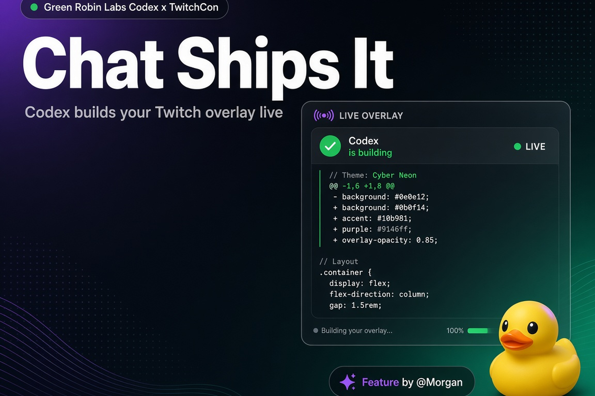

# Chat Ships It

> Viewers redeem **Ship a Feature**. Codex builds a sandboxed Twitch overlay widget live on stream.

**Green Robin Labs · Northbridge** · Codex x TwitchCon Hackathon 2026 · MIT

[Live demo](https://chat-ships-it.vercel.app) · [Interactive stream](https://chat-ships-it.vercel.app/demo) · [How we used Codex](./docs/CODEX.md)



## Why this wins

Most hackathon entries bolt AI onto chat. **Chat Ships It makes Codex the game mechanic.** Chat spends channel points, a mod approves, and the overlay shows Codex planning, streaming a diff, passing tests, then hot-loading a widget credited to the viewer. Fun to watch. Useful for communities. Obviously built with Codex.

## Features

- **Ship a Feature** redemption queue + mod `!ship` / `!revert` / `!remix`
- Live **“Codex is building…”** overlay panel (plan · diff · test light)
- Sandboxed widgets (`iframe sandbox="allow-scripts"`, no network)
- OBS browser source at `/overlay/[channel]` (transparent)
- Streamer dashboard + full interactive `/demo`
- Patch-notes ticker (“Feature by @viewer”)
- **DEMO_MODE** mock Twitch auth (no Client ID required to try)
- Optional `OPENAI_API_KEY` for live `/api/build` generation
- DEMO_MODE widget pack includes rubber duck, raid confetti, emote combo, hype pill, **sub goal thermometer**
- Shared `validateWidgetHtml` sandbox scan (forbidden APIs + size) with `npm test`

## Quick start

```bash
npm install
cp .env.example .env.local
npm run dev
```

Open [http://localhost:3000/demo](http://localhost:3000/demo).

### Environment

| Variable | Required | Notes |
|----------|----------|-------|
| `DEMO_MODE` | no (default true) | Mock Twitch OAuth + template widgets |
| `OPENAI_API_KEY` | no | Server-side only; enables live widget HTML generation |
| `TWITCH_CLIENT_ID` / `TWITCH_CLIENT_SECRET` | no | Real OAuth when DEMO_MODE=false |

**Honesty note:** This public deploy runs in **DEMO_MODE** with mock Twitch authentication because a Twitch app Client ID/Secret was not available on the build machine. The EventSub → Helix production path is documented in [`docs/WORKER.md`](./docs/WORKER.md). The overlay, build UX, sandbox, and queue are fully interactive without Twitch credentials.

## Demo video

Narrated demo (HyperFrames + Kokoro):

- **YouTube:** https://youtu.be/ghyZRheHwsg
- In-repo: [`video/renders/chat-ships-it-demo.mp4`](./video/renders/chat-ships-it-demo.mp4)
- GitHub Release: [v1.0.0 `chat-ships-it-demo.mp4`](https://github.com/dl88jing/chat-ships-it/releases/download/v1.0.0/chat-ships-it-demo.mp4)

## Codex

See [`docs/CODEX.md`](./docs/CODEX.md) for the MAIN-thread workflow and the Codex session ID (`/status`).

## Stack

- Next.js 15 (App Router) · React 19 · Tailwind 4 · Vercel
- Optional OpenAI Chat Completions for `/api/build`
- Twitch Helix + EventSub (production worker)

## License

MIT © Green Robin Labs
